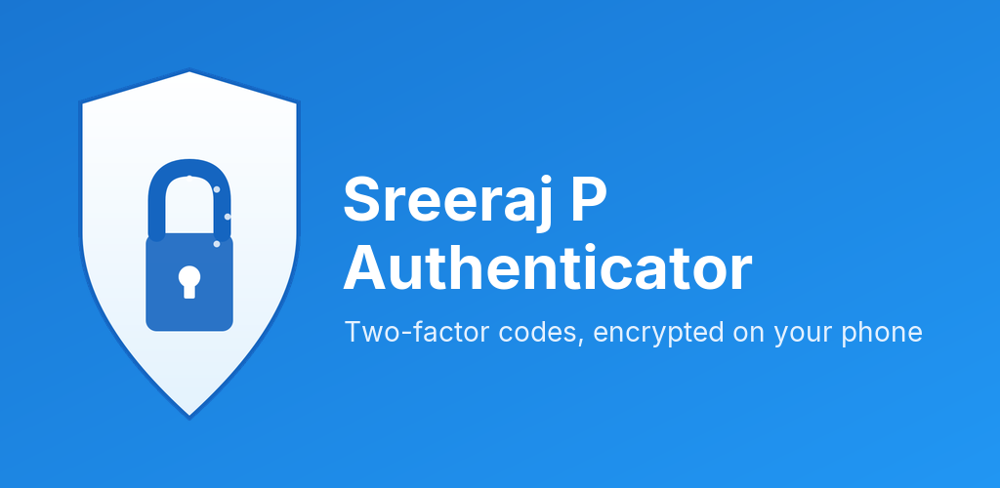
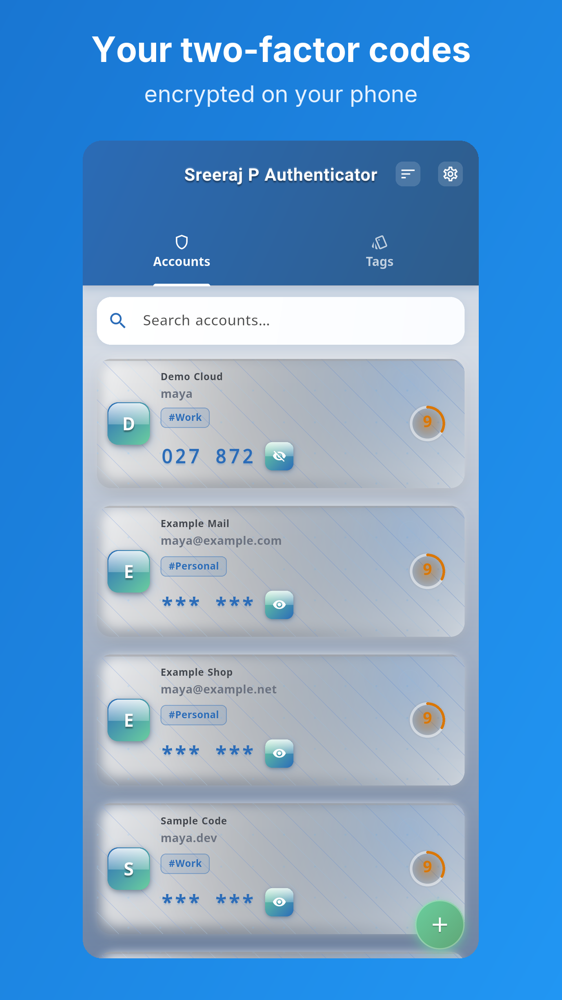
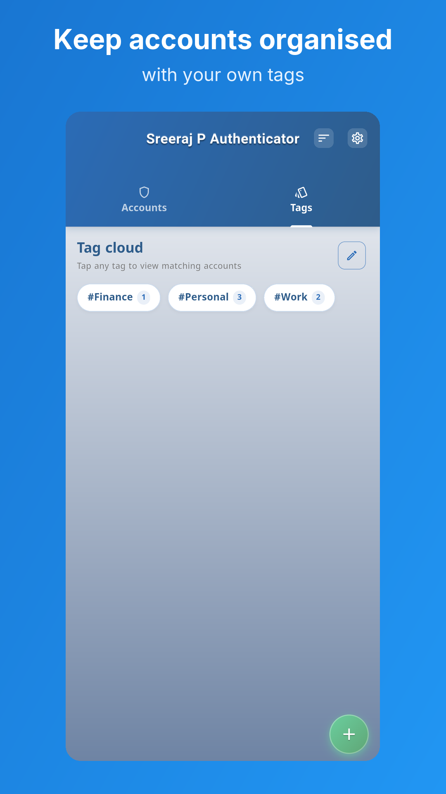
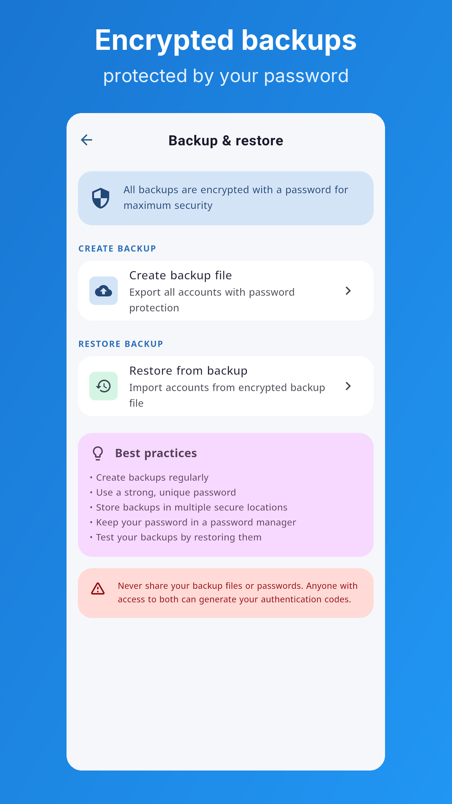
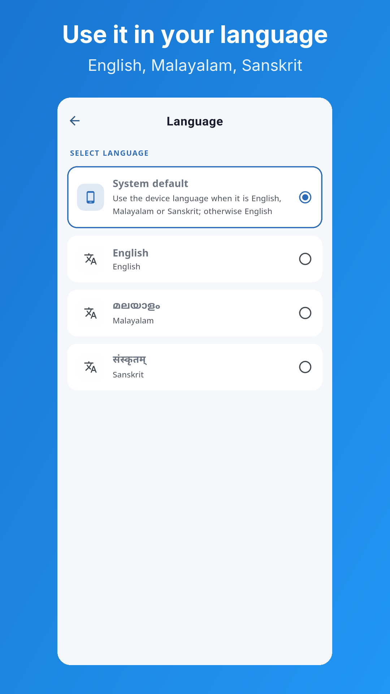
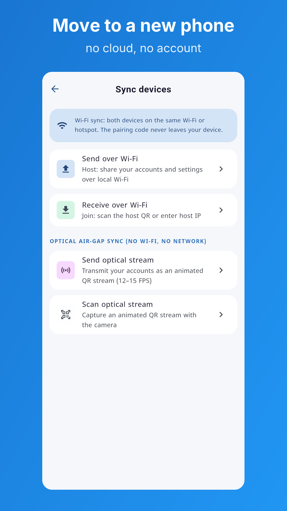
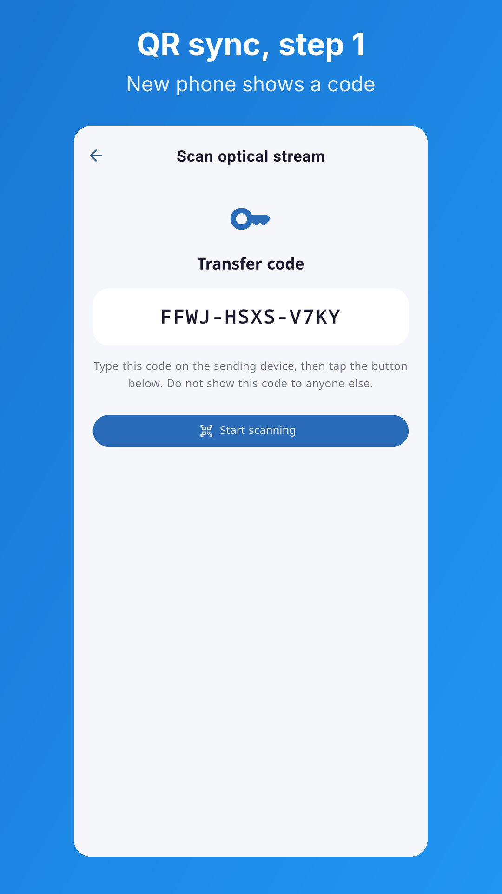
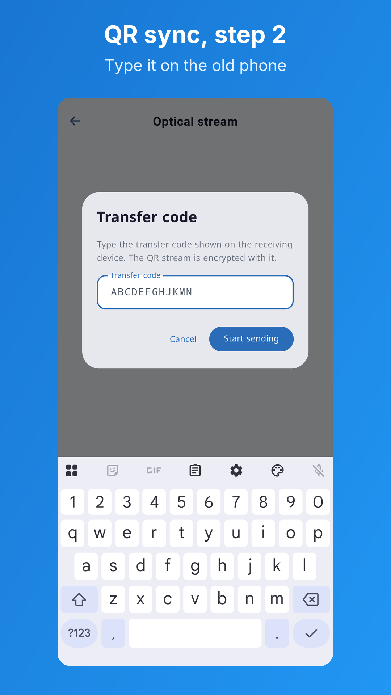
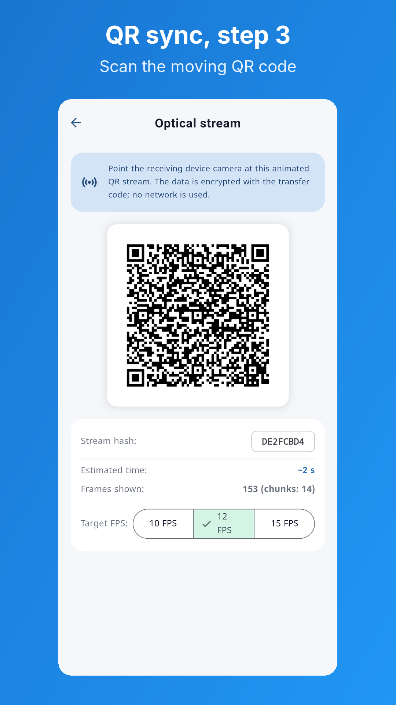

<p align="center">
  
</p>

# Sreeraj P Authenticator

A privacy-first, offline two-factor authentication (2FA) app for Android. It makes the one-time codes that protect your online accounts, and keeps your accounts encrypted on your phone.


[](LICENSE)

## Why This App

- **Offline:** codes are made on your phone. There is no cloud service behind the app.
- **No account:** there is nothing to sign up for.
- **No tracking:** no analytics, ads or crash reporting.
- **Encrypted:** account secrets are encrypted with AES-256-GCM before they are saved.
- **Yours to move:** go to a new phone by Wi-Fi, by camera, or with an encrypted backup file.
- **Open source:** MIT license, built only with open source packages.

## Screenshots

<table>
  <tr>
    <td></td>
    <td></td>
    <td></td>
    <td></td>
  </tr>
  <tr>
    <td></td>
    <td></td>
    <td></td>
    <td></td>
  </tr>
</table>

The screenshots show demo data only.

## Features

### Codes

- TOTP (time-based) and HOTP (counter-based) codes
- Steam Guard, Blizzard and YubiKey (HMAC-SHA1) accounts
- SHA-1, SHA-256 and SHA-512
- Base32 and hex secrets, detected automatically
- Add an account by QR code, or type a TOTP key by hand
- Live countdown ring for time-based codes
- Tap to copy; the clipboard is cleared after 30 seconds if it has not changed
- Hide or show each code

### Organising Accounts

- Free-form tags, with a tag cloud and a tag management screen
- Search by name, issuer or tag
- Sort by issuer, account name or date added, or drag into your own order
- Optional notes on each account
- Icons for common services, stored in the app, so no network is used
- Swipe to edit or delete, and select several accounts to delete together

### Security

- AES-256-GCM encryption for stored secrets
- Encryption key held in Android secure storage (Keystore-backed)
- Optional app lock: an App PIN, your phone's screen lock (fingerprint, face, pattern or PIN), or both
- PIN hashed with PBKDF2-HMAC-SHA256; longer lockouts after repeated wrong tries
- Recovery key, if you forget your App PIN
- Lockdown mode, which allows unlocking only with the App PIN
- Auto-lock after the time you choose
- Screenshots and screen recording blocked by default
- Delete all data from the Security screen

### Backup And Moving To A New Phone

All of these work without the internet:

- **Encrypted backup:** a password-protected `.aes` file (PBKDF2 and AES-256-GCM). Accounts you already have are skipped on restore.
- **Wi-Fi sync:** send accounts and settings directly to another phone on the same Wi-Fi or hotspot. A pairing code that is never sent over the network encrypts the session.
- **Optical air-gap sync:** send accounts as an animated QR code, read by the other phone's camera. It uses no network at all, and a one-time transfer code encrypts the frames.

### Look And Language

- English, Malayalam (മലയാളം) and Sanskrit (संस्कृतम्), changed in Settings without a restart
- System, light and dark themes

The full list is in [docs/features.md](docs/features.md).

## Availability

The app needs Android 10 or newer. A Google Play release is planned, starting with closed testing. Until then, you can build it from source using the steps below.

## Security Model

- Secrets are encrypted before they are written to the database.
- The encryption key is created on the device and is kept in `flutter_secure_storage`.
- Nothing sensitive (secrets, keys, PINs, codes) is ever written to logs.
- Android system backup is off (`android:allowBackup="false"`). The only backups are the app's own encrypted files.

Permissions:

| Permission | Why it is needed |
|------------|------------------|
| Camera | Scanning QR codes (optional) |
| Biometric | Unlocking with the phone's screen lock (optional) |
| Vibrate | Short feedback on key actions |
| Internet | Local sockets for Wi-Fi sync between your own devices only. The app has no other network use |

Out of scope: the app does not try to protect against a fully compromised or rooted device. It is designed for strong local protection on a normal consumer device.

More detail: [docs/security.md](docs/security.md) and [PRIVACY.md](PRIVACY.md).

## How To Use It

### Add An Account

1. Tap the add button on the home screen to open the QR scanner. Long-press it to choose between the scanner and manual entry.
2. Scan the QR code the website shows you, or type the account name and secret key.
3. Optionally add an issuer, tags and a note, then save.

### Lock The App

1. Open `Settings` -> `Security`.
2. Turn on app lock and choose `App PIN`, `Phone screen lock`, or both.
3. If you set an App PIN, save the recovery key. It is shown only once.
4. Set the auto-lock time.

### Back Up And Restore

1. Open `Settings` -> `Backup & restore`.
2. Create a backup with a strong password and keep the `.aes` file somewhere safe.
3. To restore, pick the file and enter the same password.

## Tech Stack

| Area | Implementation |
|------|----------------|
| UI | Flutter, `material_ui` |
| State management | `provider` |
| Local database | `sqflite` |
| Secure key storage | `flutter_secure_storage` |
| App lock | `local_auth` |
| QR scanning | `flutter_zxing`, `camera` |
| Encryption | `encrypt`, `pointycastle` |
| Sharing and files | `share_plus`, `file_picker` |

## Building From Source

You need the Flutter SDK (3.47 stable), the Android SDK, and an Android device or emulator.

```bash
flutter pub get
flutter run --flavor dev
```

Flutter sets the app's flavor from `--flavor`, so no other setting is needed.

| Flavor | Package ID | App name | Signing |
|--------|------------|----------|---------|
| `dev` | `in.sreerajp.sreerajp_authenticator.dev` | Sreeraj P Authenticator Dev | Debug keystore (automatic) |
| `prod` | `in.sreerajp.sreerajp_authenticator` | Sreeraj P Authenticator | Your release keystore (`android/key.properties`) |

Checks to run before a commit:

```bash
dart format .
flutter analyze
flutter test
```

Release APKs, split by CPU type:

```bash
flutter build apk --flavor prod --release --obfuscate --split-debug-info=build/symbols/android-prod-<version>/ --split-per-abi
```

Play Store bundle:

```bash
flutter build appbundle --flavor prod --release --obfuscate --split-debug-info=build/symbols/android-prod-<version>/
```

The full release steps are in [docs/release_process.md](docs/release_process.md).

## Project Structure

```text
lib/
|-- config/      App, flavor and locale configuration
|-- l10n/        Translations (ARB files)
|-- models/      Immutable data classes
|-- providers/   App state with Provider
|-- screens/     Route-level UI
|-- services/    OTP, auth, encryption, database, backup, sync
|-- utils/       Constants and helpers
|-- widgets/     Reusable UI components
`-- main.dart

test/            Tests, mirroring lib/
docs/            Design documents and README images
```

## Tests

The test suite includes RFC 4226 and RFC 6238 code vectors, AES-256-GCM encryption, database migrations, backup export and import, Wi-Fi and optical sync parsing, and translation checks.

## Known Limits

- Correct device time is needed for time-based codes.
- HOTP, Steam, Blizzard and YubiKey accounts can only be added by QR code or URI.
- There is no import from other authenticator apps' export formats.
- There is no plain-text export, by design.

## Documentation

- [Features](docs/features.md)
- [Architecture](docs/architecture.md)
- [Security](docs/security.md)
- [Dependencies](docs/dependencies.md)
- [Project structure](docs/project_structure.md)
- [Release process](docs/release_process.md)
- [Privacy policy](PRIVACY.md)

## License

Developed by Sreeraj P. Released under the [MIT License](LICENSE).
